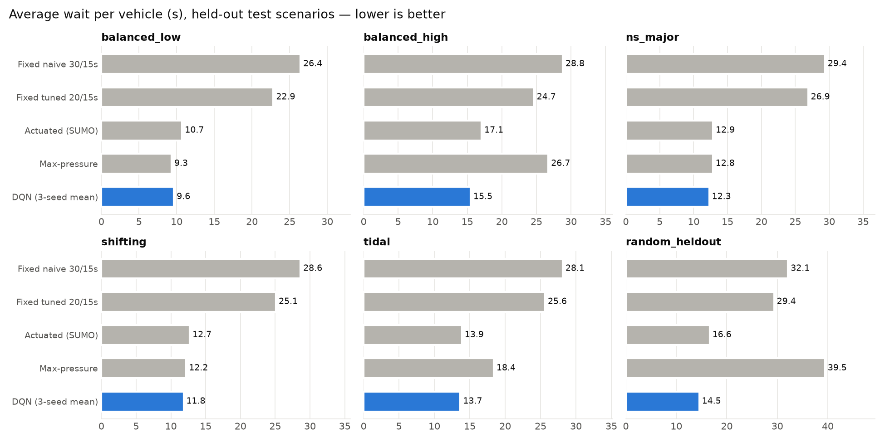
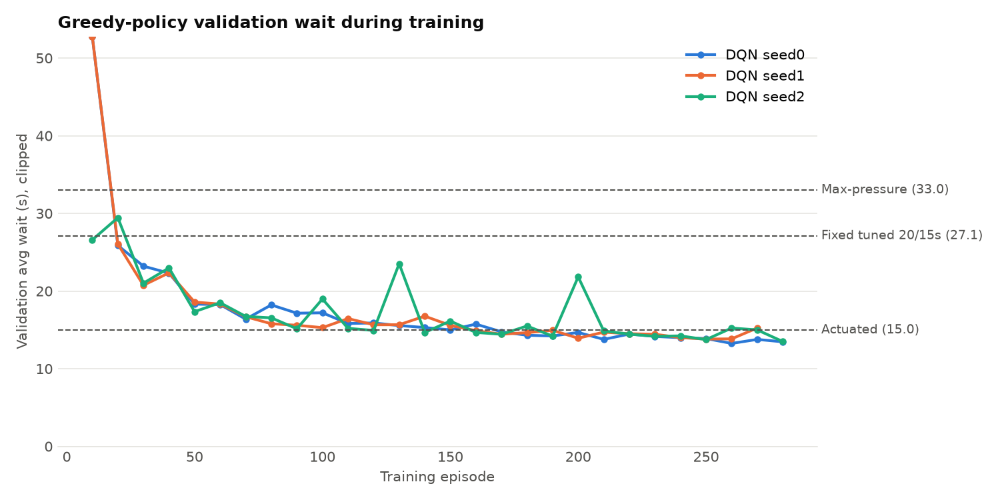

# Traffic signal control with reinforcement learning (SUMO + DQN)

A Double/Dueling DQN agent controls a 4-way signalised intersection in SUMO. It
**halves the average wait compared with a tuned fixed-time plan** (25.8 s to 12.9 s,
−49.9%, 95% CI [47.3%, 52.4%]) on held-out test traffic. All 3 training seeds beat the
fixed timer in all 30 test episodes. It also beats SUMO's built-in actuated controller,
but only by a small margin: −6.8%, better in 29/30 episodes.



## Quick start

```bash
pip install -r requirements.txt          # SUMO comes from the eclipse-sumo wheel
python -m traffic_rl.network             # build network/ (already built)
python tune_fixed.py                     # grid-search the fixed-time baseline (validation set)
python train.py --seed 0 --episodes 300  # repeat for seeds 1, 2 (about 40 min for 3 in parallel)
python evaluate.py                       # held-out test, writes results/
python demo.py --controller dqn --scenario shifting   # watch it in sumo-gui
```

## Setup

| | |
|---|---|
| Network | One intersection, 300 m approaches, 3 incoming lanes each (right+straight, straight, protected left) |
| Phases | NS through, NS left, EW through, EW left; 3 s yellow; 5 s minimum green |
| Demand | Poisson arrivals for 1 h, flows change every 15 min; the episode runs until the network empties |
| State (41) | Per lane: vehicle count, halting count, head-of-queue wait; current phase one-hot; time in phase |
| Action | Which phase gets green for the next 5 s (switching adds the yellow) |
| Reward | −(halted vehicles + vehicles waiting to enter) summed over every second. Over an episode this equals the total waiting time, which is the metric reported |
| Agent | Double + Dueling DQN, replay 200k, soft target updates (τ=0.005), Huber loss, gradient clipping, γ=0.95 |
| Safety | Max-red guard: a vehicle stopped ≥120 s forces its phase. It applies to every controller that goes through `env.step` |

### Making the comparison fair
- **Separate seeds** for train, validation and test traffic. The checkpoint and the fixed-time plan are both chosen on validation, and the test set is used once.
- **Strong baselines:** a naive fixed timer, a **grid-searched fixed timer** (20 s through / 15 s left was best), SUMO's **actuated** controller and max-pressure.
- **Same mechanics:** yellow and minimum green are identical for all controllers, and every controller sees exactly the same vehicles.
- **Metric from SUMO's tripinfo,** not from the reward: stopped time plus time spent queued to enter, with unfinished vehicles included.
- **3 independent training seeds,** all of them reported, with paired bootstrap confidence intervals.

### Handling RL instability
The training curve (below) shows the instability, with occasional spikes during training. These measures handle it:
- **Training safeguards:** reward clipping and Huber loss; the target network and Double DQN; a shorter episode cap during training, treated as truncation rather than a terminal state.
- **Checkpoint choice:** the saved model is the one with the best validation score (validation runs every 10 episodes).



## Results (30 held-out test episodes)

| Controller | Avg wait (s) | Time loss (s) | p95 wait (s) | Worst vehicle (s) |
|---|---|---|---|---|
| Fixed naive 30/15 s | 28.9 | 37.1 | 72.5 | 119 |
| Fixed tuned 20/15 s | 25.8 | 34.2 | 60.0 | 91 |
| Actuated (SUMO) | 14.0 | 21.5 | **38.2** | **80** |
| Max-pressure | 19.8 | 30.4 | 84.4 | 242 |
| **DQN (3 seeds)** | **12.9 ± 0.3** | **20.6** | 42.1 | 130 |

Per-scenario numbers and CIs are in [results/summary.md](results/summary.md), and per-episode data is in
[results/test_episodes.csv](results/test_episodes.csv).

## Limitations
- **Starvation, found and fixed.** The first version (`results/*_v1_no_guard*`) left a few lone
  vehicles stuck for up to an hour after demand ended, because one waiting car barely affects the reward.
  The fix was to add head-of-queue wait to the state and a 120 s max-red guard. The guard still fires about once per
  test episode for DQN (90 total over 3 seeds × 30 episodes).
- **DQN optimises the average, not fairness.** Its 95th-percentile and worst-case waits are
  higher than actuated control's. A fairness term in the reward would be the next step.
- **Small margin over actuated control.** The gain is 7%, so the big result is the one against fixed timing.
- **Scope.** This is one isolated intersection with synthetic demand and no pedestrians. Training
  stopped at episode 270–280 of 300 because the session was interrupted; validation had already plateaued.
